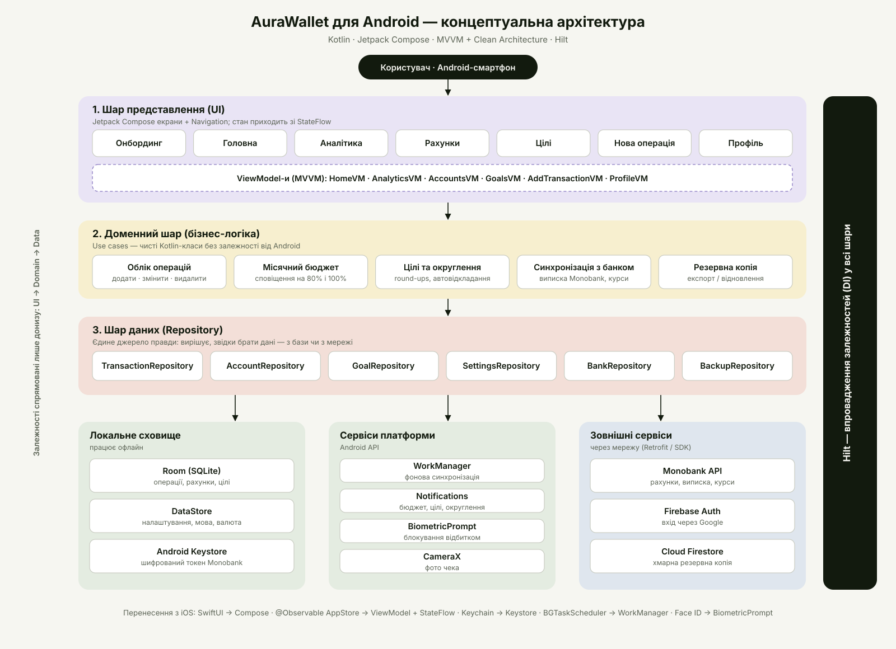

# AuraWallet for Android

Особистий фінансовий помічник: облік витрат і доходів, місячний бюджет, накопичувальні цілі з автоматичним округленням покупок та синхронізація з Monobank.

Проєкт створено в межах курсу **«Програмування мобільних додатків»** (НУ «Львівська політехніка»). Це Android-версія застосунку AuraWallet, який уже існує для iPhone (SwiftUI). Під час курсу застосунок поетапно переноситься на Android.

## Зміст

- [Структура репозиторію](#структура-репозиторію)
- [ЛР2: MVP «AI-розпізнавання витрати»](#лр2-mvp-ai-розпізнавання-витрати)
- [Запуск backend](#запуск-backend)
- [Запуск мобільного застосунку](#запуск-мобільного-застосунку)
- [API](#api)
- [AI-компонент](#ai-компонент)
- [Перевірки та тести](#перевірки-та-тести)
- [Безпека](#безпека)
- [ЛР3: Knowledge Base і «Бюджет місяця»](#лр3-knowledge-base-і-бюджет-місяця)
- [ЛР4: локальні дані (Room)](#лр4-локальні-дані-room)
- [Обмеження поточної версії](#обмеження-поточної-версії)

## Структура репозиторію

```
AuraWallet-Android/
├── backend/                  # FastAPI + Pydantic + scikit-learn
│   ├── app/
│   │   ├── main.py           # endpoints, обробка помилок
│   │   ├── schemas.py        # моделі запиту й відповіді
│   │   ├── service.py        # бізнес-логіка
│   │   ├── config.py         # налаштування зі змінних середовища
│   │   ├── categories.py
│   │   └── ai/
│   │       ├── classifier.py # AI: TF-IDF + логістична регресія
│   │       ├── parser.py     # виділення суми, валюти, магазину
│   │       └── training_data.csv
│   ├── tests/
│   ├── requirements.txt
│   └── .env.example
├── mobile/                   # Android Studio проєкт (Kotlin, Jetpack Compose)
│   └── app/src/main/java/com/aurawallet/app/
│       ├── MainActivity.kt
│       ├── data/             # Retrofit API, DTO, репозиторій, мапінг помилок
│       └── ui/               # екран, ViewModel, тема Aura
├── docs/                     # діаграми, звіти
└── README.md
```

## Ідея

Більшість людей не знає, куди йдуть їхні гроші, доки не закінчиться місяць. AuraWallet сам підтягує операції з банку, розкладає їх за категоріями й показує, скільки ще можна витратити до кінця місяця. Кожну покупку можна округлити, а різницю відкласти на ціль.



## ЛР2: MVP «AI-розпізнавання витрати»

**Сценарій:** користувач описує операцію звичайним текстом («Кава в Aroma Kava 85 грн») → застосунок надсилає опис на backend → AI визначає категорію, а парсер виділяє суму, валюту й магазин → застосунок показує результат з поясненням і впевненістю → користувач підтверджує або змінює категорію і зберігає операцію.

Сценарій взято з функціональної вимоги ФВ-1 «Облік операцій» (ЛР1): він прибирає найнудніший крок ручного введення — вибір категорії.

```
[Android: Compose-екран] --POST /api/v1/transactions/categorize--> [FastAPI]
        ^                                                              |
        |                                     parser.py: сума, валюта, магазин
        |                                     classifier.py: категорія + впевненість
        +-------------------- JSON CategorizeResponse <----------------+
```

## Запуск backend

Потрібен Python 3.11+.

```bash
cd backend
python3 -m venv .venv
source .venv/bin/activate            # Windows: .venv\Scripts\activate
pip install -r requirements-dev.txt
cp .env.example .env                 # за потреби змініть значення
set -a; source .env; set +a          # завантажити змінні середовища
uvicorn app.main:app --host 0.0.0.0 --port 8000 --reload
```

- Swagger UI: http://localhost:8000/docs
- Перевірка: `curl http://localhost:8000/health`
- Тести: `pytest -q`

Змінні середовища:

| Змінна | За замовчуванням | Призначення |
|---|---|---|
| `AI_MIN_CONFIDENCE` | `0.30` | Нижче цієї впевненості категорія = `other`, застосунок просить обрати вручну |
| `AI_SIMULATE_FAILURE` | `false` | `true` — AI завжди «падає» (перевірка сценарію помилки AI) |
| `API_KEY` | порожньо | Якщо задано, клієнт має надсилати заголовок `X-API-Key` |
| `MAX_TEXT_LENGTH` | `200` | Максимальна довжина опису |

## Запуск мобільного застосунку

1. Відкрийте папку `mobile/` в Android Studio (*File → Open*), дочекайтеся Gradle sync.
2. Адреса backend задається в `mobile/local.properties` (див. `local.properties.example`). Рекомендований спосіб — тунель ADB, він працює і на емуляторі, і на телефоні через USB, незалежно від VPN чи мережі:
   ```bash
   ~/Library/Android/sdk/platform-tools/adb reverse tcp:8000 tcp:8000   # після кожного запуску емулятора
   ```
   і в `local.properties`: `aura.apiBaseUrl=http://127.0.0.1:8000/`.
   Альтернативи: емулятор без тунелю — `http://10.0.2.2:8000/` (значення за замовчуванням; `10.0.2.2` — це `localhost` комп'ютера); телефон у тій самій Wi‑Fi — `http://<IP-комп'ютера>:8000/` (backend запускати з `--host 0.0.0.0`).
3. Запустіть backend, потім натисніть **Run ▶** у Android Studio.
4. Unit-тести клієнта: `./gradlew test` або правою кнопкою на `app/src/test` → *Run Tests*.

Стек: Kotlin 2.1, Jetpack Compose (Material 3), Retrofit + kotlinx.serialization, OkHttp, ViewModel + StateFlow. Мінімальна версія — Android 8.0 (API 26). Дозволи: лише `INTERNET`.

## API

### `GET /health`

```json
{ "status": "ok", "version": "0.2.0", "model_loaded": true, "model_classes": 17, "training_samples": 201 }
```

### `POST /api/v1/transactions/categorize`

Запит:

| Поле | Тип | Обов'язкове | Опис |
|---|---|---|---|
| `text` | string, 2–200 символів, має містити літери | так | Опис операції |
| `locale` | `"uk"` \| `"en"` | ні, `uk` | Мова підписів у відповіді |

```json
{ "text": "Кава в Aroma Kava 85 грн", "locale": "uk" }
```

Відповідь `200 OK`:

```json
{
  "category": "coffee",
  "label": "Кава",
  "confidence": 0.955,
  "is_income": false,
  "amount": 85.0,
  "currency": "UAH",
  "merchant": "Aroma Kava",
  "explanation": "Схоже на «Кава» (95%) на основі ключових слів «кава», «kava», «aroma kava». Магазин: Aroma Kava.",
  "alternatives": [
    { "category": "shopping", "label": "Покупки", "confidence": 0.005 },
    { "category": "entertainment", "label": "Розваги", "confidence": 0.005 }
  ],
  "low_confidence": false,
  "processing_ms": 1.45
}
```

Помилки завжди мають однаковий формат `{"error": {"code", "message", "field?"}}` і не містять stack trace:

| Код HTTP | `error.code` | Коли | Приклад запиту |
|---|---|---|---|
| 422 | `validation_error` | порожній/короткий текст, лише цифри, невідома мова, битий JSON | `{"text": ""}` → «Опис не може бути порожнім» |
| 401 | `unauthorized` | задано `API_KEY`, а заголовок `X-API-Key` неправильний | — |
| 503 | `ai_unavailable` | AI-модель не завантажилась або впала | — |
| 500 | `internal_error` | будь-яка інша непередбачена помилка | — |

```bash
curl -X POST http://localhost:8000/api/v1/transactions/categorize \
  -H "Content-Type: application/json" -d '{"text": "Uklon до роботи 142"}'
```

## AI-компонент

- **Задача:** класифікація короткого опису операції за 17 категоріями (ті самі, що в iOS-версії) + виділення сутностей (сума, валюта, магазин).
- **Модель:** scikit-learn `Pipeline`: TF-IDF за символьними n-грамами (2–5, стійко до відмінків і помилок) + TF-IDF за словами (1–2) → `LogisticRegression`. Навчається при старті сервісу на 201 прикладі (`training_data.csv`) приблизно за 0,2 с, працює офлайн, без зовнішніх API та ключів.
- **Пояснення:** слова з тексту з найбільшою вагою для обраної категорії.
- **Невпевненість:** якщо ймовірність < `AI_MIN_CONFIDENCE`, повертається `other` + `low_confidence: true` і варіанти — застосунок просить користувача обрати категорію.
- **Сутності:** регулярні вирази для суми й валюти (`85 грн`, `486,30`, `38 000 грн`, `$45`, `20 євро`) і словник відомих магазинів.

### Перевірка на прикладах

| # | Вхід | Очікувано | Фактично | Впевненість | Сума / магазин | Час, мс | Висновок |
|---|---|---|---|---|---|---|---|
| 1 | Кава в Aroma Kava 85 грн | coffee | coffee | 0.96 | 85 UAH / Aroma Kava | 3.0 | ✅ |
| 2 | Uklon до роботи 142 | transport | transport | 0.63 | 142 UAH / Uklon | 2.0 | ✅ середня впевненість |
| 3 | Сільпо 486,30 | groceries | groceries | 0.87 | 486.30 UAH / Сільпо | 1.3 | ✅ дробова сума з комою |
| 4 | Netflix 299 грн | subscriptions | subscriptions | 0.83 | 299 UAH / Netflix | 2.0 | ✅ |
| 5 | зарплата за листопад 38 000 грн | salary | salary | 0.73 | 38 000 UAH | 3.1 | ✅ дохід, число з пробілом |
| 6 | Bolt Food суші 650 | cafes | cafes | 0.74 | 650 UAH / Bolt Food | 1.4 | ✅ не сплутав із таксі Bolt |
| 7 | Rozetka навушники $45 | shopping | shopping | 0.96 | 45 USD / Rozetka | 1.4 | ✅ валюта USD |
| 8 | квиток на потяг до Києва 520 | travel | other (low) | 0.29 | 520 UAH | 1.5 | ⚠️ travel — перша альтернатива, користувач обирає вручну |
| 9 | ремонт велосипеда 300 | other | other (low) | 0.10 | 300 UAH | 1.6 | ✅ чесно невпевнений |
| 10 | щось незрозуміле xyz | other | other (low) | 0.09 | — | 1.4 | ✅ |

Час — обробка всередині backend (без мережі), Python 3.13.

## Перевірки та тести

| Сценарій | Очікувана поведінка | Як реалізовано |
|---|---|---|
| Коректні дані | backend повертає результат, mobile показує картку | `test_categorize_ok`, екран `ResultCard` |
| Порожні дані | запит не надсилається / відхиляється з повідомленням | валідація у `CategorizeViewModel.validate` + Pydantic → 422 |
| Backend недоступний | loading завершується, показ помилки з кнопкою «Повторити» | `IOException` → `AppError.Network`, `ErrorCard` |
| AI повернув помилку | контрольована відповідь без секретів | `AI_SIMULATE_FAILURE=true` → 503 `ai_unavailable` (`test_ai_failure_is_controlled`) |
| Неправильний JSON | клієнт не падає, показує повідомлення | `SerializationException` → `AppError.BadResponse` (`ParsingTest.brokenJsonThrows`) |
| Повторний запит | новий результат без перезапуску | `submit()` скасовує попередній `Job` і відправляє новий |

```bash
cd backend && pytest -q      # 47 тестів: парсер, бюджет, класифікатор, валідація, HTTP
```

## Безпека

- Ключі й адреси не зберігаються в коді: backend — змінні середовища (`.env` у `.gitignore`), mobile — `local.properties` (теж у `.gitignore`) → `BuildConfig`.
- Відповіді з помилками не містять stack trace — деталі лише в лог сервера.
- Тестові дані вигадані; реальні фінансові дані й токени банку не передаються.
- Android-застосунок запитує лише дозвіл `INTERNET`.

## ЛР3: Knowledge Base і «Бюджет місяця»

- **Knowledge Base:** [`docs/`](docs/README.md); правила для coding agent: [`docs/ai-instructions.md`](docs/ai-instructions.md) (на них посилаються `AGENTS.md` і `CLAUDE.md`).
- **Плани та prompts:** [`docs/lab3/`](docs/lab3): план без контексту, план з KB, порівняння, 8 prompts.
- **Нова функція:** користувач задає місячний ліміт (за замовчуванням 18 000 ₴). Після кожної збереженої операції картка «Бюджет місяця» показує витрачене, залишок, денний ліміт, розподіл за категоріями й попередження на 80% і 100%. Розрахунок виконує `POST /api/v1/budget/summary` ([контракт](docs/api-contract.md)).

Перевірка:
```bash
cd backend && pytest -q                 # 47 тестів, включно з test_budget.py і регресією ЛР2
cd mobile && ./gradlew test             # ParsingTest + BudgetTest
curl -X POST http://localhost:8000/api/v1/budget/summary -H "Content-Type: application/json" \
  -d '{"monthly_budget": 100, "transactions": [{"amount": 85, "category": "coffee"}]}'
```
Ручні сценарії: [`docs/testing.md`](docs/testing.md) (M1–M6 для ЛР2, B1–B6 для бюджету).

## ЛР4: локальні дані (Room)
Кожен успішний результат AI зберігається на пристрої (Room, `aura.db`) і переживає перезапуск.
- Кнопка з годинником у заголовку → **Історія**: новіші зверху, порожній стан, статуси «готово / очікує / надсилається».
- Натискання на запис → **Деталі** (запит, категорія, впевненість, сума, магазин, пояснення, час).
- Видалення одного запису й «Очистити» — з діалогом підтвердження.
- «Зберегти» на картці результату позначає запис як операцію; список «Збережені» і бюджет ЛР3 тепер теж з Room.
- Помилки (немає мережі, 4xx/5xx, битий JSON) **не** зберігаються.
- Підвищений рівень: при помилці мережі — «Зберегти запит і надіслати пізніше» → запис «очікує» → «Надіслати» в історії; повторне натискання не створює другого запиту.

Структура запису, рішення і сценарії перевірки: [`docs/architecture.md`](docs/architecture.md#локальні-дані-лр4), [`docs/decisions.md`](docs/decisions.md) (D16–D19), [`docs/testing.md`](docs/testing.md) (H1–H10), план: [`docs/lab4/plan.md`](docs/lab4/plan.md).

## Обмеження поточної версії

- Модель навчена на 201 вигаданому прикладі: нові магазини й рідкісні формулювання можуть отримати низьку впевненість (напр. «квиток на потяг»).
- Сума без валюти вважається гривнями; якщо в тексті кілька чисел без валюти, береться останнє.
- Історія і збережені операції лише на цьому пристрої (без синхронізації й резервної копії); ліміт бюджету не зберігається між запусками; «очікує» надсилається лише вручну.
- HTTP без шифрування дозволено для локальної розробки; для продакшну потрібен HTTPS.
- Немає синхронізації з Monobank — це окремий сценарій наступних робіт.

## Прогрес за лабораторними

- [x] ЛР1 — налаштування Android Studio, концепція, архітектура, вимоги
- [x] ЛР2 — MVP: mobile → backend → AI → результат у застосунку
- [x] ЛР3 — Knowledge Base (`docs/`), правила для coding agent, «Бюджет місяця» (`POST /api/v1/budget/summary` + картка в застосунку)
- [x] ЛР4 — локальна історія в Room: список, деталі, видалення/очищення з підтвердженням, «очікує» + «Надіслати»

## Дизайн

Макети у Figma (світла й темна теми, дизайн-система). Android-версія використовує ті самі кольорові токени Aura і шрифт Geist (SIL OFL, див. `mobile/GEIST-FONT-LICENSE.txt`).
